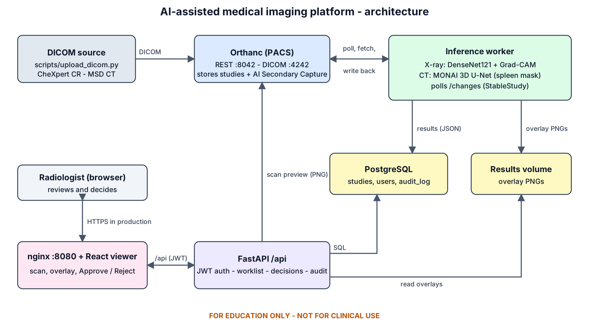

# AI-Assisted Medical Imaging and Diagnosis System

> **FOR EDUCATION ONLY - NOT FOR CLINICAL USE.** Public, de-identified data; models are course-project quality and unvalidated.

Studies uploaded to a DICOM server (Orthanc) are picked up by an inference worker, analysed by deep-learning models, shown to a
radiologist with an explanation overlay and a confidence score, and approved or rejected - every decision recorded in a
tamper-evident audit log.

```
 DICOM -> Orthanc (PACS) <-- polls /changes -- inference worker -- DenseNet121 + Grad-CAM   (chest X-ray)
             ^   Secondary Capture written back              \-- MONAI 3D U-Net            (CT, spleen)
             |                                                        |
   scripts/upload_dicom.py                              PostgreSQL: studies, users, audit_log (hash chain)
                                                                      |
 Browser (React viewer) <-> nginx :8080 <-> FastAPI /api  (auth, worklist, images, decisions, audit)
```



More detail: [`docs/ARCHITECTURE.md`](docs/ARCHITECTURE.md) (components, sequence diagram, design decisions), [`docs/API.md`](docs/API.md), [`docs/DATA.md`](docs/DATA.md).

## Results (real numbers from this repo's runs)
| | Result |
|---|---|
| Classifier (DenseNet121, CheXpert-small frontal views, 8 epochs) | best validation mean AUROC **0.804**; official test mean AUROC **0.800** over 13 scoreable classes, **0.844** over the 9 classes with >= 25 positives, **0.870** over the 5 CheXpert competition labels |
| Segmentation (MONAI 3D U-Net, MSD spleen) | best validation Dice **0.917** (8 volumes; also used for checkpoint choice); mean of last 10 checks 0.865 |

Per-class numbers with confidence intervals, calibration, subgroup results and known failures (e.g. Enlarged Cardiomediastinum is at chance on the
official test set; several classes have 0-1 test positives) are in [`docs/MODEL_CARD.md`](docs/MODEL_CARD.md) and
[`docs/LIMITATIONS.md`](docs/LIMITATIONS.md). Evaluation outputs: `reports/eval/`.

## Repo layout
```
src/            training + evaluation   data/ (dicom_wrap, nifti_to_dicom, datasets, msd, dicom_io)  models/  explain/gradcam.py
                train_cls.py  train_seg.py  evaluate.py  labels.py  config.py
services/       api/ (FastAPI)   inference/ (Orthanc worker)   common/ (db, audit hash chain)
viewer/         React + Vite, served by nginx
db/init.sql     schema + append-only triggers on audit_log
docs/           ARCHITECTURE  API  DATA  MODEL_CARD  LIMITATIONS  THREAT_MODEL  DICOM_NOTES  (+ screenshots/, audit_sample.csv, test results)
tests/          pytest          scripts/  upload_dicom.py  smoke_test.py  latency_from_logs.py  package_submission.py
params.yaml dvc.yaml            docker-compose.yml  .env.example
```

## How the models were trained
Training ran on a free Kaggle GPU (CheXpert-small attached as a Kaggle dataset; MSD Task09_Spleen downloaded in the notebook), using exactly the
commands in `dvc.yaml` and the hyperparameters in `params.yaml`:
```bash
python -m src.train_cls          # -> runs/cls/best.pt, metrics.json
python -m src.evaluate           # -> reports/eval/
python -m src.train_seg          # -> runs/seg/best.pt, metrics.json
```
`dvc repro` re-runs these stages and needs the full datasets plus a GPU. The full datasets are not redistributed (their licences apply):
CheXpert-small from Stanford AIMI (an unofficial Kaggle mirror was used here), MSD from medicaldecathlon.com / MONAI.

## Data and weights with DVC
Small, redistributable artefacts are versioned with DVC: the demo DICOMs (`data/dicom`, `data/dicom_ct`) and the weights
(`models/cls_best.pt`, `models/seg_unet.pt`). They are **not** stored in Git; Git holds only the small `.dvc` pointer files.
The DVC remote is a plain folder named `dvc-remote` that must sit **next to** the repo folder:
```
some-folder/
  dvc-remote/        <- unzip dvc-remote.zip here (from the latest GitHub Release, or the Drive folder)
  medimaging-ai/     <- this repository
```
```bash
pip install dvc
dvc pull            # restores data/dicom*, models/*.pt (remote is configured as ../dvc-remote)
```
`dvc status -c` should report the cache and remote as in sync. It may also warn that outputs of the `train_cls`, `train_seg` and `evaluate` stages are
"missing version info": those stages were executed on a Kaggle GPU, so their outputs are committed as plain files in `reports/` (and the weights are tracked
as `models/*.pt`) rather than produced by `dvc repro` on this machine.

## Run the platform
```bash
cp .env.example .env     # fill every blank (see comments); Windows: copy .env.example .env
docker compose up --build
python scripts/upload_dicom.py data/dicom    --password "<ORTHANC_PASSWORD>"   # 48 chest X-ray studies
python scripts/upload_dicom.py data/dicom_ct --password "<ORTHANC_PASSWORD>"   # 2 CT volumes (slow on CPU)
python scripts/smoke_test.py                 # end-to-end check against the running stack
```
Open http://localhost:8080 and sign in as the radiologist from `.env`. Orthanc's own UI is at http://localhost:8042.
In the viewer: pick a study, toggle the overlay or switch finding, then **Approve** or **Reject** (a reason is required to reject).
The **Audit log** tab lists every login, view and decision and can verify the hash chain.

## Security notes (details in `docs/THREAT_MODEL.md`)
Role-checked API with bcrypt + JWT and login lockout; append-only audit log enforced by database triggers **and** a SHA-256 hash chain that
detects edits even if the triggers are disabled; nginx security headers/CSP; services bound to localhost; containers run with dropped
capabilities. Known gaps (no TLS in the default compose, JWT in sessionStorage, in-memory lockout) are listed there.

## Tests
```bash
python -m pytest -q tests        # audit chain, DICOM wrap, datasets, Grad-CAM (torch tests skip without torch)
python scripts/smoke_test.py     # needs the stack running
```

## Screenshots
Stored in `docs/screenshots/`: worklist, chest X-ray overlay, CT mask overlay, approve, reject-with-reason, audit verify (intact),
audit verify (tamper detected), Orthanc studies.

## Submission checklist
- [ ] Code + `dvc.yaml`/`params.yaml` + DVC config (`.dvc/`, `*.dvc`) and the `dvc-remote/` folder
- [ ] Weights (`models/*.pt`, also in the DVC remote)
- [ ] `docs/` (model card, limitations, threat model, DICOM notes), `reports/eval/`, `docs/audit_schema.txt`, `docs/audit_sample.csv`
- [ ] Screenshots and a short demo video
- [ ] `docker compose up` verified from a clean copy; `ORTHANC_TAG`/image versions pinned

## License
Code: MIT (see `LICENSE`). The datasets keep their own licences and are not redistributed (see `docs/DATA.md`);
the trained weights are provided for education only.
