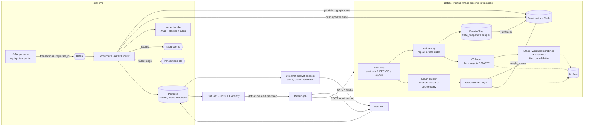

# Architecture

## Feature state (Feast `user_state`)
`n_txn, mean_amt, m2_amt, ew_cnt_short, ew_cnt_long, last_ts, last_device, last_country` + `graph_scores(graph_score, cluster_size)`.

## Engineered features (22)
Amount: `log_amount, amount_vs_avg, amount_zscore, drain_ratio, amt_mean`. Velocity: `velocity_short (1h), velocity_long (24h), time_since_last, n_prior_txn`.
Behaviour change: `is_new_user, device_changed, geo_changed, device_geo_changed`. Context: `hour, dow, type_*`.

## Failure handling
Poison message -> DLQ topic, offset committed. Duplicate delivery -> ignored by unique `txn_id`. Missing graph score -> XGBoost only.
Unknown user -> empty state (`is_new_user=1`). API `/health` stays up without a model; `/score` loads lazily.
