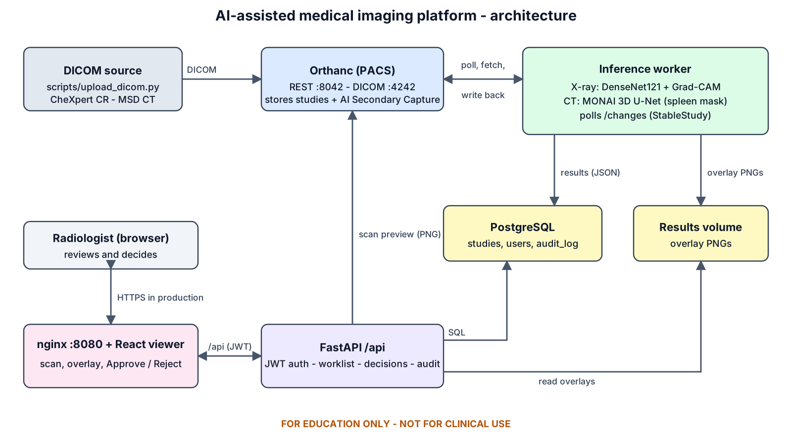
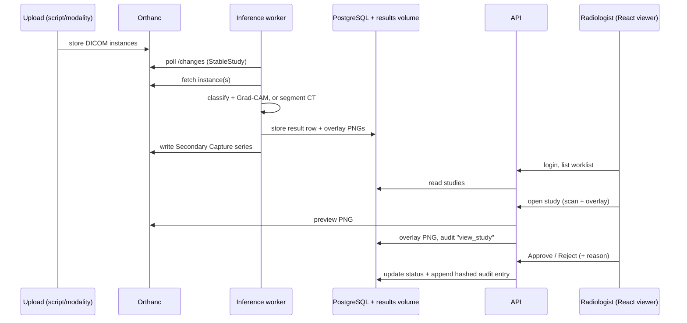

# Architecture

> FOR EDUCATION ONLY - NOT FOR CLINICAL USE.

(Editable source: `architecture.svg`.)

## Components
| Component | Technology | Role |
|---|---|---|
| Orthanc | `orthancteam/orthanc` (pinned by digest in `docker-compose.yml`) | DICOM server (PACS): stores studies, serves previews, receives the AI Secondary Capture. Auth enabled, ports bound to localhost. |
| Inference worker | Python, PyTorch, MONAI, `services/inference/` | Polls Orthanc `/changes` for `StableStudy`, loads the DICOM, runs the model, saves overlay PNGs and the result row, writes a Secondary Capture back. |
| Classifier | DenseNet121 (ImageNet transfer learning), Grad-CAM | 14 CheXpert findings; top-3 findings get overlays. |
| Segmenter | MONAI 3D U-Net | Spleen mask and volume on CT. |
| API | FastAPI, `services/api/` | JWT auth, worklist, image/overlay delivery, Approve/Reject, audit endpoints. |
| Database | PostgreSQL 16 | `studies`, `users`, `audit_log` (append-only triggers + SHA-256 hash chain). |
| Viewer | React + Vite, served by nginx | Worklist, scan with overlay, confidence, decisions, audit tab. nginx adds security headers/CSP and proxies `/api`. |
| Packaging | Docker Compose | Five services; only the viewer (8080) and Orthanc (8042, 4242) are published, on 127.0.0.1. |

## Study lifecycle

## Key design decisions
- **Polling Orthanc instead of a plugin or callback:** the worker stays a plain, restartable Python service. The cost is a few seconds of latency (poll interval plus Orthanc's stable-age wait).
- **One shared preprocessing module** (`src/data/transforms.py`) used by training and serving, so the model sees the same input pipeline in both places. 8-bit wrapped DICOMs are passed through without re-stretching.
- **Human in the loop:** every result starts as `pending_review`; only a `radiologist` can approve or reject, rejection requires a reason, and a study can be decided once (row lock + status check).
- **Tamper-evident audit log:** database triggers block UPDATE/DELETE/TRUNCATE, and each row's hash covers the previous hash, so edits made even by a privileged user are detected by `GET /api/audit/verify`. Tail truncation needs an externally stored head hash to detect.
- **Overlays as files, results as rows:** images live in a volume the API serves read-only; metadata and decisions live in PostgreSQL.
- **Secrets only via `.env`** (git-ignored), required at startup; the API refuses to run with a weak `JWT_SECRET`.

## Where to look in the code
`services/inference/main.py` (poll loop) - `services/inference/pipeline.py` (models) - `services/api/main.py` (routes) - `services/common/audit.py` (hash chain) -
`db/init.sql` (schema and triggers) - `viewer/src/` (UI) - `src/` (training and evaluation).
